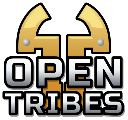

# OpenTribes



AN MIT licensed re-creation of the Tribes 2 in a 2012 fork of the Torque 3D Game Engine.

## Project Goals

- **Goal 0:** Porting the Torque 3D engine to modern systems; adding support for other processor architectures (AMD64/ARM64) and platforms (native Linux/MacOS/Android support).
- **Goal 1:** Program behaviour should be indistinguishable from the stock Tribes 2 game; the user should be able to log in, select a mission or join a server, play a game of single-player or multi-player Tribes 2, fully compatible with the proprietary 2001 retail version of the Tribes 2 game, including scripts and mods.
- **Goal 2:** Add cool new features, for example: SSR reflections, bloom, anti-aliasing, modern OpenGL/Vulcan support, physics objects, ragdolls (keeping backward compatibility with the original retail game in all cases).

## Setting up a Development Environment

Currently, only Linux is supported as a development environment for OpenTribes.

### Procuring the Retail Game

In order to develop the OpenTirbes you need to download and install the retail Tribes 2 gmae. This project does *NOT* include any copyrighted material from the original game.
- Download source 1: [The-Construct](https://www.the-construct.net/downloads/tribes2/tribes2gsi.exe)
- Download source 2: [TribesNext](https://depot.tribes2.net/legacy/tribes2gsi.exe)
### Installing System Dependencies

(Depending on your Linux distro your mielage may vary)

```bash
sudo pacman -S --needed base-devel cmake ninja git python just
```

### Building and Running OpenTribes

- To build a debug build: `just debug`.
- To build a release build: `just release`.
- To build and run the OpenTribes: `just opentribes` (runs telnet on `:2324` by default).
- To run the stock game (as a tool for comparison): `just stock` (runs telnet on `:2324` by default).
- To connect to the running instance via telnet: `just telnet`.

For a full list of commands and arguments to pass see: `just --list`.

# License

Permission is hereby granted, free of charge, to any person obtaining a copy
of this software and associated documentation files (the "Software"), to
deal in the Software without restriction, including without limitation the
rights to use, copy, modify, merge, publish, distribute, sublicense, and/or
sell copies of the Software, and to permit persons to whom the Software is
furnished to do so, subject to the following conditions:

The above copyright notice and this permission notice shall be included in
all copies or substantial portions of the Software.

THE SOFTWARE IS PROVIDED "AS IS", WITHOUT WARRANTY OF ANY KIND, EXPRESS OR
IMPLIED, INCLUDING BUT NOT LIMITED TO THE WARRANTIES OF MERCHANTABILITY,
FITNESS FOR A PARTICULAR PURPOSE AND NONINFRINGEMENT. IN NO EVENT SHALL THE
AUTHORS OR COPYRIGHT HOLDERS BE LIABLE FOR ANY CLAIM, DAMAGES OR OTHER
LIABILITY, WHETHER IN AN ACTION OF CONTRACT, TORT OR OTHERWISE, ARISING
FROM, OUT OF OR IN CONNECTION WITH THE SOFTWARE OR THE USE OR OTHER DEALINGS
IN THE SOFTWARE.
